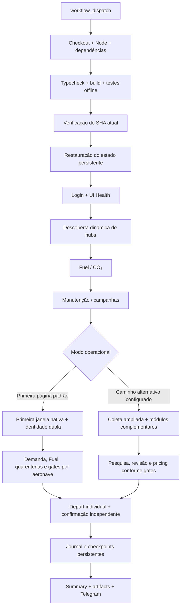

# ✈️ Airline Manager 4 Automation

[](https://github.com/andreypiekas/Airline-Manager-4-Automation/actions/workflows/validate.yml)
[](https://www.typescriptlang.org/)
[](https://playwright.dev/)
[](LICENSE)

Automação operacional para **Airline Manager 4 (AM4)** construída com **TypeScript, Playwright e GitHub Actions**.

O projeto automatiza rotinas repetitivas da companhia aérea com uma abordagem **fail-closed**: antes de executar uma ação no jogo, o bot tenta validar contexto, identidade, demanda, recursos e controles nativos da interface. Quando não há evidência suficiente, a operação é mantida em `HOLD` em vez de assumir dados ou repetir ações de forma incerta.

> [!WARNING]
> **Projeto não oficial e não afiliado ao Airline Manager 4.** Automação pode contrariar regras ou termos do jogo. O projeto reduz riscos operacionais do próprio bot, mas **não oferece garantia contra bloqueios, limitações ou banimento da conta**.

---

## Principais recursos

| Recurso | Estado |
| --- | --- |
| Login e leitura da frota | ⚠️ Produção; interface nativa pode falhar ou ficar incompleta |
| Descoberta automática de hubs/bases | ✅ Produção |
| Demand Manager | ✅ Ativo com validação individual e `HOLD` conservador |
| Decolagens individuais | ⚠️ Ativas na primeira página; cobertura global não garantida |
| Elegibilidade de rotas em qualquer aeroporto | ✅ Sem filtro por hub; não equivale a examinar toda a frota |
| Compra de Fuel com preço ao vivo | ✅ Produção |
| Compra de CO₂ | ✅ Produção |
| Manutenção, A-check e reparos | ✅ Produção |
| Campanhas de marketing | ✅ Produção |
| Pricing automático PAX | ✅ Produção |
| Pesquisa de rotas | ✅ Leitura |
| Revisão de rota no retorno/diária | 🛡️ Implementada; condicionada ao caminho operacional e a evidências |
| Reroute automático | 🛡️ Fail-closed; não é garantido no despacho por primeira página |
| Histórico e quarentenas persistentes | ✅ Produção; nunca apagar o estado para liberar partidas |
| Threshold adaptativo de demanda | ✅ Produção |
| Dashboard no GitHub Actions | ✅ Produção |
| Notificações via Telegram | ✅ Produção |
| Modo semiautomático com aprovação manual | ✅ Produção |
| Renomeação de aeronaves | 🧰 Workflow manual separado | 
| Compra automática de aeronaves | ❌ Fora do escopo |

O estado técnico detalhado está em [docs/IMPLEMENTATION_STATUS.md](docs/IMPLEMENTATION_STATUS.md).

### Situação operacional verificada em 06/11/2026

> [!IMPORTANT]
> **Testes offline aprovados não significam que a operação real esteja estabilizada.** O modo padrão de produção analisa somente a **primeira página nativa da Fleet**, não todas as rotas. Uma execução verde representa apenas o escopo efetivamente verificado, nunca o processamento integral da frota.

- Na execução [#1559](https://github.com/andreypiekas/Airline-Manager-4-Automation/actions/runs/42221987958), **3 decolagens foram confirmadas**, 3 aeronaves ficaram em `HOLD` por demanda insuficiente e 1 foi bloqueada devido a uma **tentativa antiga com resultado incerto**. O workflow terminou em falha para não mascarar essa pendência.
- Na [#1560](https://github.com/andreypiekas/Airline-Manager-4-Automation/actions/runs/42226001875), a primeira página ficou curta e sem candidatos verificados, embora o cabeçalho indicasse **187 rotas**; não foi possível concluir que não havia aviões prontos nas outras páginas.
- Nesses cenários, os limites de combustível, as confirmações pós-clique e as quarentenas foram mantidos. **Não use a cor verde/vermelha isoladamente para avaliar o número de voos realizados.** Confira `IndividualDepartures`, `ScopedFirstPageOutcome` e os artifacts.

**Limitações pendentes:** cobertura integral da frota, recuperação de páginas incompletas, conciliação de partidas incertas e diagnóstico de manutenção com horas não verificadas.

---

## Como o bot trabalha

O bot não usa uma lista fixa de aeroportos para decidir quais aeronaves podem decolar.

### Decolagens em qualquer aeroporto

Para uma **rota já existente**, o executor é deliberadamente **base-agnostic**.

Isso significa que uma aeronave pronta pode ser processada independentemente do aeroporto atual, desde que os demais requisitos sejam confirmados:

- aeronave e rota identificadas de forma única;
- estado realmente pronto para decolagem;
- demanda recente e suficiente;
- capacidade e layout consistentes;
- botão nativo de `Depart` validado;
- estoque de Fuel compatível quando houver evidência disponível;
- ausência de quarentena operacional;
- orçamento de tempo suficiente para concluir e confirmar a ação.

As bases/hubs da companhia são relevantes para funções que realmente dependem de uma **origem operacional**, como revisão de rota e reroute. Elas **não limitam o despacho normal das rotas existentes**.

### Descoberta dinâmica de hubs

Em cada execução autenticada, o bot pode consultar a interface nativa do AM4 em modo de leitura e descobrir os hubs pertencentes à companhia.

Os IDs observados são cruzados com o catálogo local de aeroportos. A lista live só é usada quando pode ser resolvida de forma consistente.

Existe um **fallback configurável** para os hubs caso a descoberta live não possa ser comprovada.

Assim, uma nova base pode ser reconhecida automaticamente sem precisar alterar o código do executor de decolagem.

---

## Modo padrão: somente primeira página da Fleet

Em produção, `DEMAND_FIRST_PAGE_ONLY` é **`true` por padrão**. O bot reabre a primeira página nativa, faz leituras independentes, verifica cada candidato READY individualmente, despacha apenas os autorizados e tenta observar novamente a primeira página após partidas confirmadas. Não percorre automaticamente todas as páginas da frota nesse modo.

- `DISPATCH_ALL_READY` ou `maxDepartures=all` significa **todos os candidatos elegíveis alcançados pelo fluxo e pelo orçamento da execução**, não as 187 rotas do cabeçalho.
- O jogo pode manter aviões que decolaram na lista, reordenar cartões ou mostrar uma página curta. A contagem de `Routes(N)` não comprova os cartões ausentes.
- A reconciliação exige identidades e estados exatos. Não é permitido deduzir que um avião desaparecido decolou, nem repetir uma partida incerta.
- `ROLLING_INDIVIDUAL_WINDOW_NO_VERIFIED_CANDIDATES` indica que o bot não conseguiu obter **candidatos verificados naquela página**, e **não** que a companhia inteira está parada.
- Quarentenas persistidas podem gerar `FIRST_PAGE_DISPATCH_INCOMPLETE_OR_UNVERIFIED` mesmo depois de outras partidas reais e confirmadas.
- Desabilitar `DEMAND_FIRST_PAGE_ONLY` muda para um caminho de coleta diferente; não use isso como correção improvisada para uma UI instável.

> [!CAUTION]
> Não apague a branch `am4-runtime-state`, não remova registros de quarentena e não reduza os requisitos de confirmação para transformar uma run vermelha em verde.

## Demand Manager

Antes de autorizar uma decolagem, o Demand Manager avalia a capacidade disponível e a demanda restante.

Entre os controles estão:

- demanda por classe `Y / J / F`;
- capacidade da aeronave;
- idade da observação;
- compartilhamento conservador de demanda entre aeronaves;
- threshold mínimo configurado;
- threshold adaptativo baseado em histórico verificado;
- identidade única da rota e da aeronave.

O threshold adaptativo pode elevar o limite quando o histórico fornece evidência suficiente. Ele não reduz o piso configurado com dados fracos ou incompletos.

A configuração avançada do Demand Manager está em [docs/VARIABLES.md](docs/VARIABLES.md).

---

## Pricing automático

O módulo de pricing parte do **Auto Price nativo do AM4** e aplica:

```text
Y = Auto Price × 1.10
J = Auto Price × 1.08
F = Auto Price × 1.06
```

O valor final é normalizado para múltiplos de 10.

O fluxo exige:

1. leitura do Auto Price;
2. cálculo do alvo;
3. validação do contexto da rota;
4. `Save` somente quando autorizado;
5. releitura da tarifa após o salvamento;
6. confirmação explícita do resultado.

Uma alteração cujo resultado fique incerto não é repetida automaticamente.

---

## Route Review e Reroute

A revisão de rota pode acontecer:

- após um retorno confirmado à base operacional; ou
- uma vez ao dia quando a aeronave é observada em solo na própria base.

As decisões são classificadas como:

- **KEEP** — manter a rota atual;
- **HOLD** — evidência insuficiente ou cenário não seguro para alteração;
- **REROUTE** — existe candidata superior e todos os gates obrigatórios foram satisfeitos.

Um reroute real só pode ocorrer quando a comparação é fresca e suficientemente completa, incluindo os controles internos `comparisonReady` e `mutationAuthorized`.

O bot não trata uma lista parcial de sugestões como prova da melhor rota global.

---

## Fuel e CO₂

O módulo de suprimentos usa o **preço observado ao vivo na interface**.

O bot verifica preço, capacidade disponível, limites configurados e contexto antes da compra.

Os tetos, limites por execução e reserva de caixa estão documentados em [docs/VARIABLES.md](docs/VARIABLES.md).

Após uma tentativa, estoque e resultado financeiro são relidos. Resultado inconclusivo entra em quarentena e não é repetido automaticamente.

---

## Segurança operacional

A arquitetura foi construída em torno de alguns princípios:

1. **Fail-closed** — falta de evidência significa não executar.
2. **Sem retry após mutação incerta** — uma ação que pode ter sido executada não é clicada novamente às cegas.
3. **Confirmação pós-operação** — departures, pricing e supplies precisam de evidência posterior.
4. **Estado persistente** — histórico e quarentenas sobrevivem aos runners efêmeros do GitHub Actions.
5. **Proteção contra rerun** — produção real rejeita reruns do mesmo GitHub Actions run.
6. **Proteção contra código obsoleto** — o SHA é conferido antes da fase autenticada.
7. **UI nativa validada** — controles precisam corresponder ao contexto esperado antes de um clique.
8. **Dados ausentes não viram zero** — valores econômicos ou operacionais desconhecidos permanecem desconhecidos.
9. **Limites por execução** — mutations são limitadas para reduzir impacto de comportamento inesperado.
10. **Orçamento de tempo** — nenhuma fase crítica começa quando não há janela suficiente para concluí-la com segurança.
11. **Challenges não são contornados** — CAPTCHA ou verificação interativa interrompe a run sem tentativa de resolução.

---

## Fluxo de execução



O workflow principal é:

```text
.github/workflows/playwright.yml
```

Execuções simultâneas são serializadas para evitar duas automações atuando sobre a mesma companhia ao mesmo tempo.

---

## Instalação

### Requisitos

- Node.js 22+
- npm
- Chromium compatível com Playwright
- ambiente suportado pelo Playwright
- interface do Airline Manager 4 em **inglês**

### Criar seu fork

Para usar o bot na sua própria conta, faça primeiro um **fork** deste repositório no GitHub. Na criação do fork, selecione **Copy the DEFAULT branch only**; o workflow criará o estado persistente próprio na primeira execução.

Depois, se quiser trabalhar localmente, clone **o seu fork**:

```bash
git clone https://github.com/SEU_USUARIO/Airline-Manager-4-Automation.git
cd Airline-Manager-4-Automation

npm ci
npx playwright install --with-deps chromium
```

Secrets e Variables devem ser configurados no seu fork.

### Validar localmente

```bash
npm run typecheck
npm run build:state
node scripts/company-dashboard.cjs --self-test
npm test
```

Essas validações são offline e não precisam acessar a conta do jogo.

---

## Configuração no GitHub

> **Guia de instalação completo:** [GitHub Actions + Secrets + Variables + cron-job.org](docs/GITHUB_AND_CRON_SETUP.md)

Depois de criar o fork, habilite **Actions** nele e abra:

**Seu fork → Settings → Secrets and variables → Actions**

### Secrets obrigatórios

| Secret | Descrição |
| --- | --- |
| `EMAIL` | E-mail da conta utilizada no AM4 |
| `PASSWORD` | Senha da conta |

### Telegram opcional

| Secret | Descrição |
| --- | --- |
| `TELEGRAM_BOT_TOKEN` | Token do bot |
| `TELEGRAM_CHAT_ID` | ID da conversa ou grupo de destino |

> `TELEGRAM_CHAT_ID` deve ser o ID da conversa, não o ID do próprio bot.

### Configuração avançada

As demais Repository Variables são opcionais e possuem valores padrão seguros no workflow.

Para personalizar demanda, hubs, limites de departures, Fuel/CO₂, manutenção, campanhas, pricing, route review e reroute, consulte:

**[docs/VARIABLES.md — referência completa de Variables](docs/VARIABLES.md)**

Não é necessário criar todas as Variables para começar.

---

## Execução

O workflow suporta dois modos principais.

### Production

Executa as operações autorizadas pelos módulos e gates de segurança.

```text
departure_mode=production
```

### Simulation

Mantém as principais mutações desativadas para inspeção controlada.

### Semiautomático

Quando habilitado pela configuração avançada, o bot apenas analisa o cenário e envia um resumo pelo Telegram. Operações reais exigem confirmação manual para aquela run.

```text
departure_mode=simulation
```

> Uma run `success` significa apenas que **as verificações exigidas para seu escopo foram satisfeitas**; não prova que toda a frota foi examinada. Uma run `failure` também pode ter decolagens reais e comprovadas, acompanhadas de quarentenas ou páginas incompletas. Sempre compare os logs operacionais com os artifacts.

---

## Agendamento externo

O workflow operacional usa `workflow_dispatch` e não depende de um schedule interno.

Isso permite acionamento manual ou por um serviço externo, como **cron-job.org**.

Endpoint:

```text
POST https://api.github.com/repos/SEU_USUARIO/Airline-Manager-4-Automation/actions/workflows/playwright.yml/dispatches
```

Body:

```json
{
  "ref": "main"
}
```

Para automação externa, use um **Fine-grained Personal Access Token** limitado ao repositório e com a permissão mínima necessária para executar GitHub Actions.

Veja [docs/GITHUB_AND_CRON_SETUP.md](docs/GITHUB_AND_CRON_SETUP.md) para o passo a passo completo do GitHub e cron-job.org, ou [AUTOMACAO.md](AUTOMACAO.md) para a operação diária.

---

## Estado persistente

O bot mantém histórico operacional separado do código.

Branch de runtime:

```text
am4-runtime-state
```

Em um fork novo ela é criada automaticamente com um journal vazio; não é necessário copiar a branch de runtime do repositório original.

O journal registra, entre outras evidências:

- decolagens confirmadas;
- passageiros observados após a partida;
- retornos/chegadas;
- revisões de rota;
- histórico de demanda;
- Flight History observado;
- HOLDs;
- mutations incertas;
- informações necessárias aos thresholds adaptativos.

**Nunca apague a branch `am4-runtime-state` nem suas quarentenas para forçar tentativas.** Uma decolagem anterior incerta só pode ser desbloqueada por nova evidência nativa e pela resolução persistida no journal; o avião não é reenviado na execução que o regulariza.

### Política de branches e limpeza

O repositório separa três tipos de branch:

- `main` — código de produção e documentação;
- `am4-runtime-state` — histórico, checkpoints e quarentenas usados pelos workflows (deve permanecer);
- `fix/*`, `feat/*`, `docs/*` e semelhantes — desenvolvimento temporário.

A limpeza utiliza [scripts/prune-merged-branches.cjs](scripts/prune-merged-branches.cjs) e o workflow [Limpeza segura de branches mescladas](.github/workflows/prune-merged-branches.yml).

A auditoria complementar de 06/11/2026 está em [docs/BRANCH_AUDIT_2026-11-06.md](docs/BRANCH_AUDIT_2026-11-06.md). O script [retire-audited-branches.cjs](scripts/retire-audited-branches.cjs) tem uma lista de SHA exatos para branches antigas revisadas e também reconhece branches comprovadamente ancestrais da `main`; ele é independente da rotina de limpeza de PRs mesclados. São elegíveis **somente** branches com PR **mesclado** no próprio repositório e **SHA atual idêntico ao SHA do PR**. Não são removidas branches com PR aberto, com commits posteriores ao merge, sem PR mesclado, protegidas, `main`, `migration-stable` ou `am4-runtime-state`.

Por padrão, o script executa apenas uma auditoria sem excluir nada:

```bash
# Autoteste sem token
node scripts/prune-merged-branches.cjs --self-test

# Auditoria por GitHub API, sem exclusão
GITHUB_REPOSITORY=SEU_USUARIO/SEU_REPO GITHUB_TOKEN=SEU_TOKEN node scripts/prune-merged-branches.cjs --dry-run
```

Para exclusão, use o workflow com aprovação explícita (`apply=true`) ou o argumento `--apply` com token de escopo restrito e permissão `Contents: write`. O workflow também realiza a limpeza quando o script ou a configuração de manutenção é incorporada à `main` **deste repositório**, com relatório auditável no GitHub Actions.

---

## Dashboard e relatórios

Cada execução pode produzir:

- **GitHub Step Summary** com visão executiva;
- `demand-report` com relatórios JSON/Markdown;
- `playwright-report` com evidências técnicas;
- estados operacionais consolidados;
- relatórios de pricing, rotas e supplies;
- resumo opcional via Telegram.

O dashboard prioriza o que precisa de atenção em vez de repetir toda a frota em cada execução.

---

## Estrutura do projeto

```text
.github/workflows/   GitHub Actions
data/reference/      catálogo e referências estáticas
demand/              demanda e decolagens
optimization/        rotas, economia, histórico e journal
pricing/             pricing PAX
supplies/            Fuel e CO₂
scripts/             dashboard, estado e notificações
tests/live/          probes controlados
tests/unit/          suíte offline
utils/               login e módulos operacionais
docs/                documentação técnica
```

---

## Troubleshooting

**A run ficou verde, mas nenhum avião decolou**

Consulte `IndividualDepartures`, `ScopedFirstPageOutcome` e `execution-report.md`. Um resultado concluído não significa que todas as aeronaves da frota foram observadas. Uma run `skipped` também não comprova operação.

**A run ficou vermelha, mas aviões decolaram**

Veja o relatório da execução: partidas confirmadas são preservadas. A validação pode permanecer vermelha por quarentena prévia não resolvida, identidade divergente ou próxima página incompleta. Não repita partidas incertas.

**`PERSISTED_UNCERTAIN_DEPARTURE_BLOCK`**

Uma tentativa de outra execução permaneceu sem confirmação conclusiva. O journal deve ser conciliado com nova observação READY estritamente posterior, identidade/rota/registro compatíveis e controle nativo válido. Não apague o histórico.

**`ROLLING_INDIVIDUAL_WINDOW_NO_VERIFIED_CANDIDATES`**

A primeira página nativa não forneceu candidatos READY verificáveis. Isso não demonstra ociosidade da frota; confira o cabeçalho, a integridade da página, os logs de recuperação e as demais execuções.

**Fuel não foi comprado**

Verifique preço ao vivo, teto configurado, capacidade disponível, caixa mínimo e possíveis quarentenas.

**Reroute não ocorreu**

A comparação provavelmente não atingiu todos os gates necessários. O executor prefere manter a rota a executar uma troca sem evidência suficiente.

**Telegram retorna erro 403**

Confirme que `TELEGRAM_CHAT_ID` corresponde à conversa/grupo e que o bot já recebeu uma mensagem ou foi iniciado no destino.

**Uma run antiga não acessou o jogo**

O guard de SHA pode ter identificado que o código no `main` mudou enquanto aquela execução aguardava na fila.

---

## Documentação

| Documento | Conteúdo |
| --- | --- |
| [docs/README.md](docs/README.md) | Índice técnico |
| [docs/GITHUB_AND_CRON_SETUP.md](docs/GITHUB_AND_CRON_SETUP.md) | Configuração completa do GitHub e cron-job.org |
| [docs/CONFIGURATION.md](docs/CONFIGURATION.md) | Secrets e inputs do workflow |
| [docs/VARIABLES.md](docs/VARIABLES.md) | Todas as Variables avançadas, defaults e efeitos |
| [docs/DEMAND_MANAGER.md](docs/DEMAND_MANAGER.md) | Regras de demanda |
| [docs/PRODUCTION_DEPARTURES.md](docs/PRODUCTION_DEPARTURES.md) | Executor de decolagens |
| [docs/ROUTES_AND_PRICING.md](docs/ROUTES_AND_PRICING.md) | Route review, reroute e pricing |
| [docs/SUPPLIES.md](docs/SUPPLIES.md) | Fuel e CO₂ |
| [docs/RESERVATIONS_AND_COSTS.md](docs/RESERVATIONS_AND_COSTS.md) | Reservas e custos |
| [docs/REPORTS_AND_TELEGRAM.md](docs/REPORTS_AND_TELEGRAM.md) | Dashboard, artifacts e Telegram |
| [docs/IMPLEMENTATION_STATUS.md](docs/IMPLEMENTATION_STATUS.md) | Estado técnico atual |
| [AUTOMACAO.md](AUTOMACAO.md) | Guia operacional |
| [docs/archive/](docs/archive/) | Histórico de desenvolvimento |

---

## Contribuições

Issues e pull requests são bem-vindos, especialmente para:

- melhorar compatibilidade com alterações da UI do AM4;
- ampliar testes de parsing e segurança;
- melhorar observabilidade e relatórios;
- tornar a documentação mais clara;
- adicionar novos módulos sem enfraquecer os gates existentes.

Mudanças operacionais devem manter o comportamento **fail-closed**.

---

## Licença

Distribuído sob a licença **MIT**.

Os avisos e atribuições herdados do projeto de origem permanecem preservados em [LICENSE](LICENSE).

---

### Autor

**Andrey Gheno Piekas**

Projeto desenvolvido para experimentação, automação e estudo de operações no Airline Manager 4.
